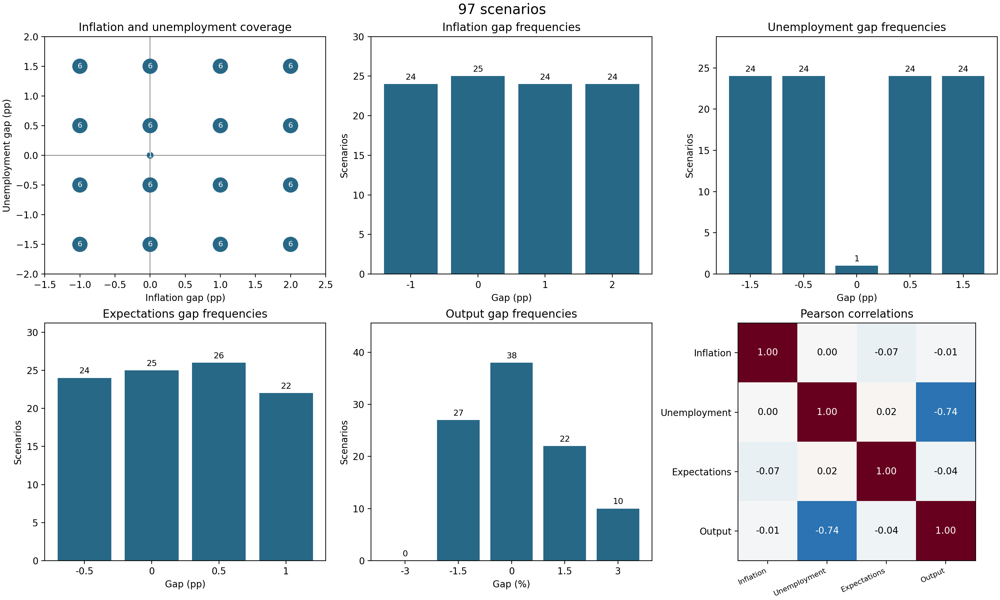
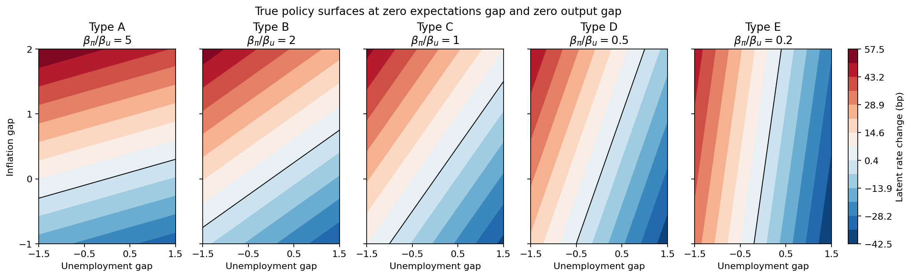

# Macroeconomic Scenarios and Synthetic Policymakers

Reproducible experimental materials for studying whether an LLM can infer monetary-policy preferences from observed decisions. Task 1 builds plausible macroeconomic scenarios; Task 2 supplies five policymakers with known reaction functions, shared decision histories, and held-out ground truth.

**Status (11 November 2026):** the full local pipeline and saved-table checks pass. Task 2 materials remain **provisional** pending review of the scenario design and policy rules. Prompt conditions and model calls (Tasks 3–4) have not been implemented. The results below measure properties of synthetic data, not LLM performance.

For the group meeting, start with the [中文汇报稿](docs/meeting_summary.md). See [methods](docs/methods.md) for design details and [data provenance](data/README.md) for the bundled inputs.

## Current results

| Component | Result | Evidence |
| --- | --- | --- |
| Historical panel | 104 quarters, 2000Q1–2025Q4; 103 complete Okun observations | [Processed data](data/processed/macro_quarterly_2000_2025.csv) |
| Okun calibration | Output gap = 0.156371 − 0.946960 × unemployment gap | [Calibration and robustness checks](results/task1/okun_calibration.json) |
| Scenario construction | 320 candidates → 144 eligible → 96 stratified scenarios + neutral S000 | [Scenario table](results/task1/scenarios.csv) |
| Policymakers | Five types; true inflation/employment weight ratios 5, 2, 1, 0.5, 0.2 | [Coefficient table](results/task2/policymaker_types.csv) |
| Provisional split | 48 train / 48 test; neutral control stored separately | [Split](results/task2/provisional/scenario_split.csv) |
| Provisional histories | 20 shared scenarios per type; nested prefixes of 2, 5, 10, 20 | [Decision histories](results/task2/provisional/decision_histories.csv) |
| Validation | No history/test overlap; rank, coverage, rounding, and preference-order checks pass | [Verification](results/verification.txt), [generator diagnostics](results/task2/provisional/check_report.txt) |

### Scenario coverage



Each of the 16 inflation–unemployment cells contributes six base scenarios. The extra all-zero scenario is S000. Other marginal frequencies are not constrained to be equal.

### True policy surfaces



Expectations and output gaps are held at zero. Colors show continuous rate changes in basis points; black lines mark zero. From A to E, the rule places progressively more weight on employment relative to inflation.

## Reproduce

Tested with **Python 3.9.13**, NumPy 2.0.2, pandas 2.3.3, and Matplotlib 3.9.4. The original Task 1 document records Python 3.13; the environment used for the current regenerated artifacts is recorded in [run_manifest.json](results/run_manifest.json). Other environments have not been verified.

From the repository root, create an environment and install the pinned dependencies. On Windows PowerShell:

```powershell
python -m venv .venv
.venv\Scripts\python.exe -m pip install -r requirements.txt
.venv\Scripts\python.exe scripts/run_pipeline.py
```

On macOS/Linux, use `.venv/bin/python` in place of `.venv\Scripts\python.exe`.

The pipeline uses bundled raw CSVs and makes no network requests or model calls. It regenerates the managed files in `data/processed/` and `results/`, stops at the first failed step, and writes `results/pipeline.log` (ignored by Git). A successful run also writes the verification report and a manifest of code, input, and output SHA-256 hashes. Image bytes can vary across plotting environments; compare tables and scientific checks when changing environments.

Individual steps can also be run with the same Python interpreter:

```text
python scripts/preprocess.py
python scripts/calibrate_okun.py
python scripts/generate_scenarios.py
python scripts/generate_policymakers.py
python scripts/verify_results.py
```

## Repository layout

```text
data/
  raw/                  Bundled source snapshots; pipeline leaves them unchanged
  processed/            Merged quarterly historical panel
docs/
  methods.md            Current design, assumptions, and limitations
  meeting_summary.md    Chinese group-meeting narrative and review questions
  *.docx                Original research documents, preserved unchanged
  archive/              Legacy preprocessing reference and initial checksums
scripts/                Preprocessing, calibration, generation, validation, runner
results/
  task1/                Calibration, scenarios, diagnostics, and presentation order
  task2/                Internal coefficients and policy surface figure
    provisional/        Split, histories, test targets, neutral control, metadata
  verification.txt      Cross-file scientific checks
  run_manifest.json     Environment and file hashes from a successful run
```

## Use in subsequent experiments

The current Task 2 tables contain internal ground truth. A future prompt builder must explicitly select the four gaps and rounded `decision_bps` for history examples, and only the four gaps for held-out questions. Do not serialize whole rows: type labels, coefficients, latent rates, region tags, and correct test decisions are internal material.

The [original Task 2 note](docs/task2_progress_note.docx) reports an earlier provisional run with seed 21. Regeneration from the current Task 1 table selects seed **775**; current outputs and [methods](docs/methods.md) supersede the old run-specific numbers. S000 is reserved as a separate control and is not part of the stratified train/test split. These design choices remain open for supervisor review before material is locked.

For maintenance, edit the scripts and rerun the pipeline instead of editing generated CSVs. Keep the raw snapshots fixed when reproducing this run. Do not relabel provisional data as final until the design is approved. No software license has been selected; upstream data attribution is documented separately.

## GitHub handoff

This directory has been initialized with the local branch name `research/task1-task2`. No commit or remote push has been made. The files selected by `git add --dry-run .` were checked; caches, the virtual environment, and runtime logs are ignored.

To publish this directory as a branch, create or choose the GitHub repository, replace the URL below with its clone URL, and run:

```text
git add .
git commit -m "Organize reproducible Task 1 and Task 2 research materials"
git remote add origin "YOUR_GITHUB_REPOSITORY_URL"
git push -u origin research/task1-task2
```

If integrating with an existing checked-out project, copy these research files into a new branch of that checkout, excluding this directory's `.git` and `.venv`, and follow that repository's submission workflow.
