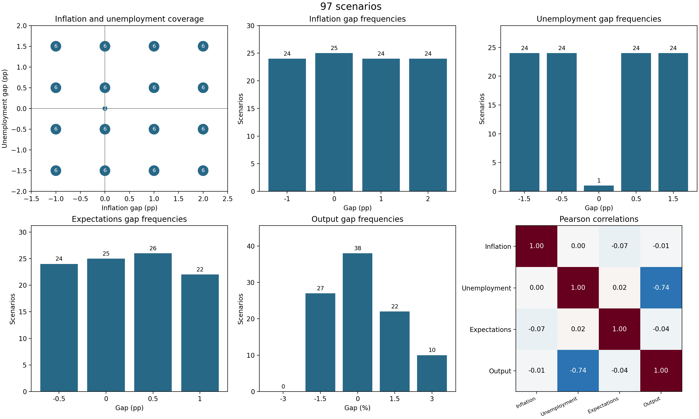
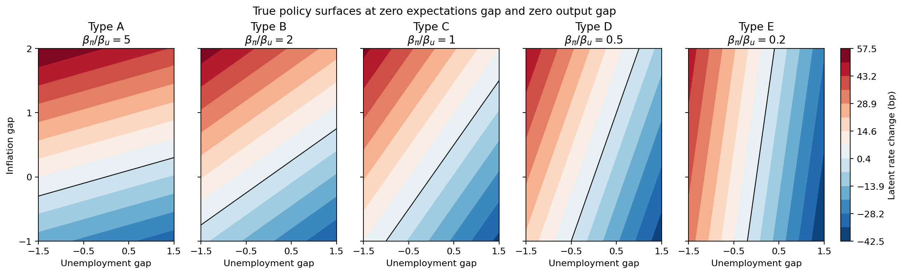

# 组会汇报：宏观经济情景与偏好已知的政策制定者

汇报日期：2026 年 11 月 12 日。材料整理与复现日期：2026 年 11 月 11 日。

## 开场：这项工作要解决什么问题

后续实验想研究：LLM 能否根据一个政策制定者过去的决策，识别其对通胀和就业的相对偏好，并把这种偏好迁移到新的经济情景？

为使这个问题可以检验，我先搭建两个基础部分：一是有历史数据依据的宏观经济情景，二是偏好由我们明确设定的政策制定者。这样后续模型给出决策后，就有已知的真实规则作为比较基准。

**目前完成的是实验材料与合成基准的建设和验证，还没有调用 LLM。**

## 第一部分：Task 1 已完成什么（约 2 分钟）

我整理了美国 2000—2025 年的历史数据，构造通胀、失业、通胀预期和产出四个缺口。季度面板有 104 期，其中失业与产出缺口完整的样本为 103 期。

用这个样本估计 Okun 关系，得到：

```text
产出缺口 = 0.156371 − 0.946960 × 失业缺口
斜率常规标准误：0.045868
斜率 Newey–West 标准误：0.060119（4 阶季度滞后）
```

去掉 2020 年，斜率为 −0.953943；只用四变量全部完整的共同样本，斜率为 −0.935856。两种处理下斜率都与基准接近。

随后构造四个变量的 320 个离散组合，用历史回归残差的 2.5%—97.5% 经验分位区间筛选，保留 144 个。在 16 个“通胀缺口 × 失业缺口”格子中，各抽六个，得到 96 个基础情景，再添加一个四缺口全为零的中性情景，共 97 个。



讲图时可以指出：左上角每个基础格子都是六个；右下角失业与产出缺口的相关系数约为 −0.74，反映筛选规则保留了负相关关系。预期和产出的边际分布并没有强制均衡，筛选也不能保证四变量的所有联合关系都符合现实。

可展示文件：[情景表](../results/task1/scenarios.csv)、[校准结果与稳健性检查](../results/task1/okun_calibration.json)。

## 第二部分：Task 2 已完成什么（约 2 分钟）

我设置了五类政策制定者。它们对通胀和就业的总权重相同，但相对权重逐渐变化；对通胀预期和产出的权重保持一致。

| 类型 | 通胀权重 | 就业权重 | 通胀/就业偏好比 |
| --- | --- | --- | --- |
| A | 25 | 5 | 5 |
| B | 20 | 10 | 2 |
| C | 15 | 15 | 1 |
| D | 10 | 20 | 0.5 |
| E | 5 | 25 | 0.2 |

决策是四个缺口的线性函数，失业缺口以负号进入。连续决策按照 5 个基点取整，恰好位于中点时远离零取整。



这张图固定预期缺口与产出缺口为零。从 A 到 E，零利率变动线由接近水平逐渐转为接近竖直，直观表示政策从偏重通胀逐步转向偏重就业。这是设定的真实规则，不是模型学习出的结果。

96 个基础情景按格子分为 48 个训练情景和 48 个测试情景。五类政策制定者共用同一套历史情景，每类生成 20 条决策；前 2、5、10、20 条形成嵌套历史，后续可以比较历史长度的作用。中性情景 S000 单独保留为控制情景，暂不进入训练或测试划分。

可展示文件：[参数表](../results/task2/policymaker_types.csv)、[决策历史](../results/task2/provisional/decision_histories.csv)、[划分表](../results/task2/provisional/scenario_split.csv)。

## 第三部分：如何知道材料是可靠的（约 1 分钟）

已经实际从原始 CSV 跑通“预处理 → 历史校准 → 情景生成 → 政策决策生成 → 文件一致性验证”的完整流程。

- 整理后的 Task 1 情景 CSV 与整理前逐字节一致。
- 训练与测试没有交叉，全部历史都来自训练集，五类共享相同的历史情景。
- 5、10、20 条历史的设计矩阵均满秩；前五条覆盖紧缩、宽松和边界状态；每个格子最多贡献两条历史。
- 保存的历史决策和测试答案都能按公式与取整规则重新算出。
- 用测试集的合成决策反推偏好比，得到 A—E 约为 **4.744、1.984、0.990、0.494、0.198**，保留了真实偏好的严格排序。

最后一项说明取整后的合成材料仍有区分度，不代表 LLM 已经能够识别偏好，也不代表所有系数都能无误差恢复。

复现入口是 `python scripts/run_pipeline.py`；验证证据见 [verification.txt](../results/verification.txt) 和 [Task 2 检查报告](../results/task2/provisional/check_report.txt)。

## 希望老师确认的设计选择

| 选择 | 当前方案 | 希望确认的原因 |
| --- | --- | --- |
| 决策粒度 | 5 bp | 能保留较小系数的作用，但需要确认与研究问题的匹配程度 |
| 偏好构造 | 通胀与就业权重之和固定为 30 | 比较时主要改变偏好构成；需确认系数尺度合理 |
| 中性情景 | S000 单独作为控制 | 它不属于可对半划分的基础格子；需确认其后续实验用途 |
| 情景筛选 | 使用历史 Okun 残差区间 | 约束失业与产出关系；需确认是否需要额外的联合合理性检查 |

这些输出继续标记为 **provisional**。待设计确认后，再锁定输入情景的哈希、重新生成材料，并更新状态。

## 下一步

Task 3 将实现 behavior-only、label-only、aligned、conflict 和 neutral-control 条件。历史示例只向模型提供四个缺口和取整后的决策；测试问题只给四个缺口。反应函数、内部类型名、连续决策、区域标签和正确测试答案都不进入 prompt。

Task 4 再开展 pilot，观察预测误差、反推偏好排序及历史长度的影响。具体模型、重复次数和评分口径尚需确定。

## 可能被问到的问题

**为什么是 97 个情景，却只有 48/48 的划分？**

96 个基础情景按 16 个格子各六个构造，训练测试各三个。额外的 S000 是单独控制情景。

**为什么不用 25 bp？**

较粗的取整可能使预期与产出的小幅变化无法改变观察到的决策，削弱偏好识别。当前用 5 bp 保留这些作用。这是需要讨论的设计选择；本次整理没有重新做 25 bp 对照实验，旧进展文档中的对应数值不能当作本次新验证结果。

**为什么旧文档写 seed 21，现在是 775？**

旧文档记录的是较早的临时运行。本次在当前 Task 1 情景表上按相同算法重新搜索，选择的是 775。当前材料、元数据和方法说明已统一，原 Word 文档作为历史记录保留。

**历史数据与假想情景的自然失业率设定是否一样？**

历史校准用随时间变化的 NROU；假想情景用固定 4.5% 的参考失业率。两者都以失业缺口表达，设定差异已在数据说明中列出。

**阈值能复现吗？**

可以。已补足 Python 校准脚本，经验分位数口径复现原阈值。默认线性插值会得到略有不同的数值，因此方法说明明确记录了算法。

**这些能否证明 LLM 已经学到了偏好？**

目前只能说明实验材料已生成、内部一致性检查通过。是否能学到偏好，需要后续模型实验回答。
